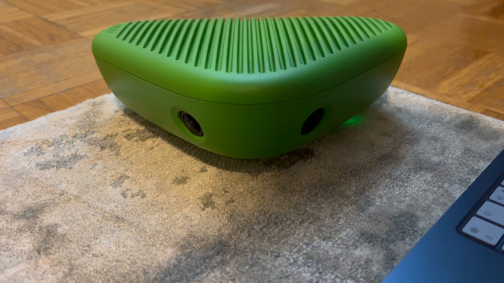
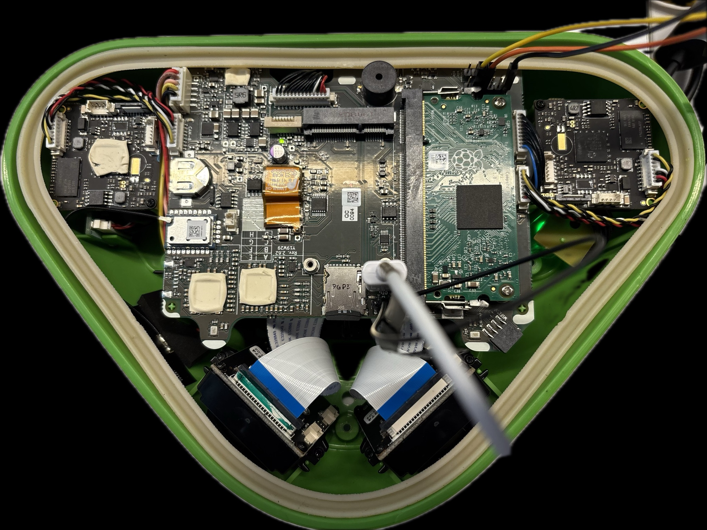
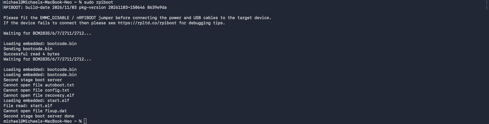
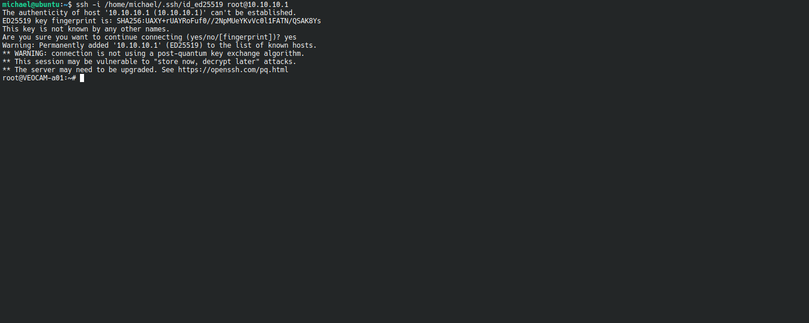

+++
author = "Michael Lappas"
cover = "/post/2026-11-16/veocam1/images/front.png"
date = 2026-11-15T10:46:58-05:00
keywords = ["Veo Cam 1", "Reverse engineering"]
lastmod = 2026-11-15T10:46:58-05:00
pin = true
summary = "Accessing Veo Cam 1 recordings without relying on Veo's website."
title = "Veo Cam 1: Accessing recordings without relying on Veo's website"
+++

I recently purchased a Veo Cam 1 and was disappointed to discover that retrieving recorded footage requires accessing Veo's website. Fortunately, I managed to develop a workaround that eliminates this requirement.

Opening the device revealed that it is built around a Raspberry Pi Compute Module 3 (CM3).

Located just below the Micro-USB Type-B connector is a three-pin header. Bridging the middle and rightmost pins disables the normal eMMC boot process and forces the CM3 into `RPIBOOT` mode, where it waits for bootcode from a USB host. Using Raspberry Pi's official `rpiboot` utility, the host computer supplies the necessary bootcode, allowing the CM3's onboard eMMC to be made accessible as a USB mass storage device. The eMMC can then be accessed directly to read and write its contents.

Since the device runs Linux and already has an SSH server enabled, I decided to take advantage of this. I created an `authorized_keys` file at `/home/root/.ssh/authorized_keys` and added my SSH public key to it. Retrieving recordings was now as simple as logging into the device via SSH and copying the video files from the `/mnt/sdcard/recordings` directory.

I hope this proves useful to other Veo Cam 1 owners looking for a way to access their recorded footage without relying on Veo's website.

*Special thanks to Branden, Cameron, and Jack for their help.*
